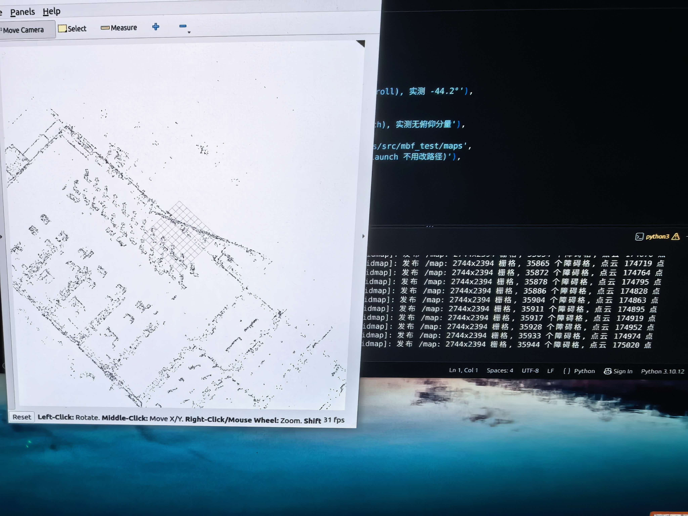
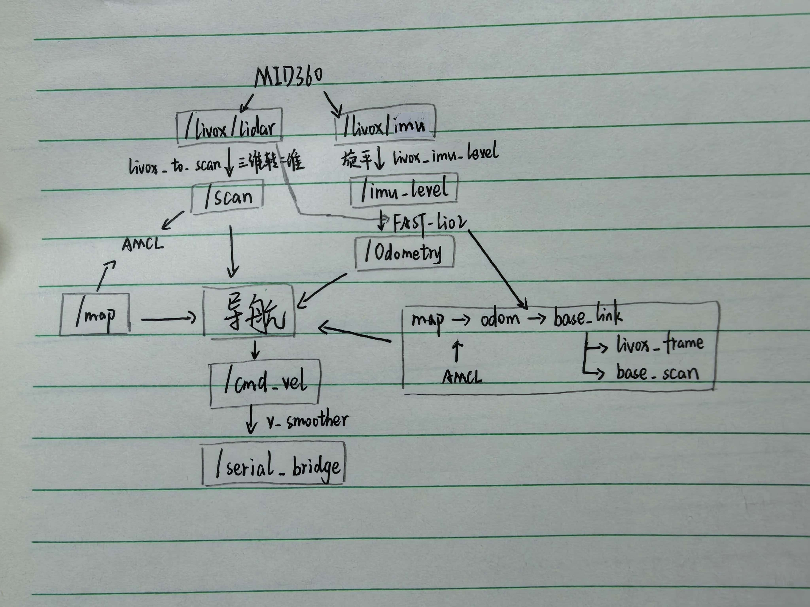

# 导航方向大考核
## 1.架构
本方案目前能够实现建图过程3D点云实时转为二维占据栅格地图、简单导航和多目标导航。采用mbf框架+theta*全局规划器+DWB局部规划器实现导航。
## 2.建图
使用fast_lio2接收点云建图，经体素降采样、高度筛选、障碍物判定处理后压成二维栅格地图。

|主要话题名称|作用|发布方|订阅方|
|---|---|---|---|
|/Laser_map|发送3D点云建图|fastlio_mapping|live_gridmap|
|/map|发送二维地图|live_gridmap|RVIZ|
             
效果展示

## 3.导航
### 3.1 使用MBF框架+nav2planner+nav2
 1.不需要编写行为树/不被原有行为树框架限制（多目标导航/重规划）

 2.换规划器更方便/可采用多个规划器动态选择/

 3.依旧可以使用nav2配好的成熟规划器和控制算法

### 3.2 使用theta*+DWB
1.theta*路径更直(视线检查)，麦轮非常适配（任意角）

2.DWB支持全向运动、评价函数

### 3.3 主要数据流


## 4.问题与解决

### 4.1 小车启动就开始脱困 
为什么：雷达斜装存在地面环/把自己当障碍物

怎么解决： 截断地面/地面射线滤波，足迹滤波
### 4.2 漂移
谁导致：AMCL/FAST_LIO?  

为什么：累积？几何特征退化？时间戳？... 

怎么解决： 加大扫描特征，减小自愈强度/odom_guard,reloc_guard

### 4.3 动态避障
原因： 看不见/避不开

为什么：滤波范围过大，时间戳对不上丢包...

...尚未解决

## 5.主要参数
1.全局代价地图膨胀半径与代价缩放因子

2.局部代价地图膨胀半径与代价缩放因子

3.DWB障碍物权重  0.02-->0.5

4.路径贴合权重 32-->16

5.yaw_goal_tolerance  0.25-->6.28 (放弃终点朝向)

## 6.使用方法
需要根据实车更改串口通信、base_link +x方向、足迹滤波尺寸、雷达偏转角与相对位置
### 6.1 建图
终端一：启动雷达驱动
```bash
source ~/final/install/setup.bash
ros2 launch livox_ros_driver2 msg_MID360_launch.py
```
终端二：拉起二维建图
```bash
source ~/final/install/setup.bash
ros2 launch t11_10 mapping_car.launch.py
```
ctrl+c关掉终端二，地图自动保存在导航栈
### 6.2 导航
和建图一样的终端一

终端二：拉起导航栈
```bash
source ~/final/install/setup.bash
ros2 launch mbf_test real_car.launch.py
```
RVIZ会自启动，且已配好代价地图、路径、TF等，给初始位姿和目标就可以导航了

多目标导航需要再拉起一个
```bash
source ~/final/install/setup.bash
ros2 run mbf_test multi_goal_nav.py
```
这个使用的是publish point，并且设置完多点需要在这个终端enter
